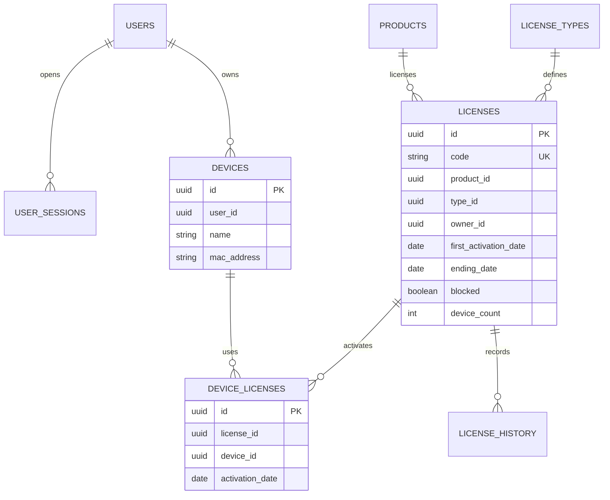
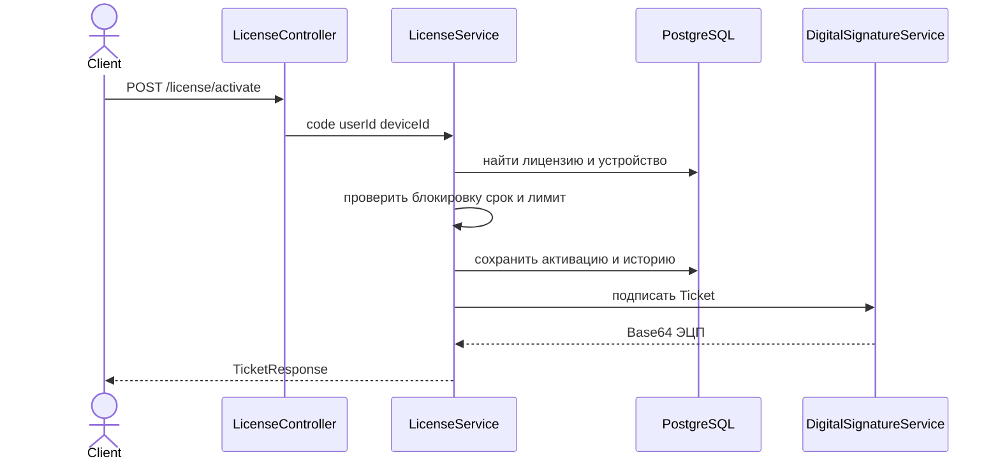
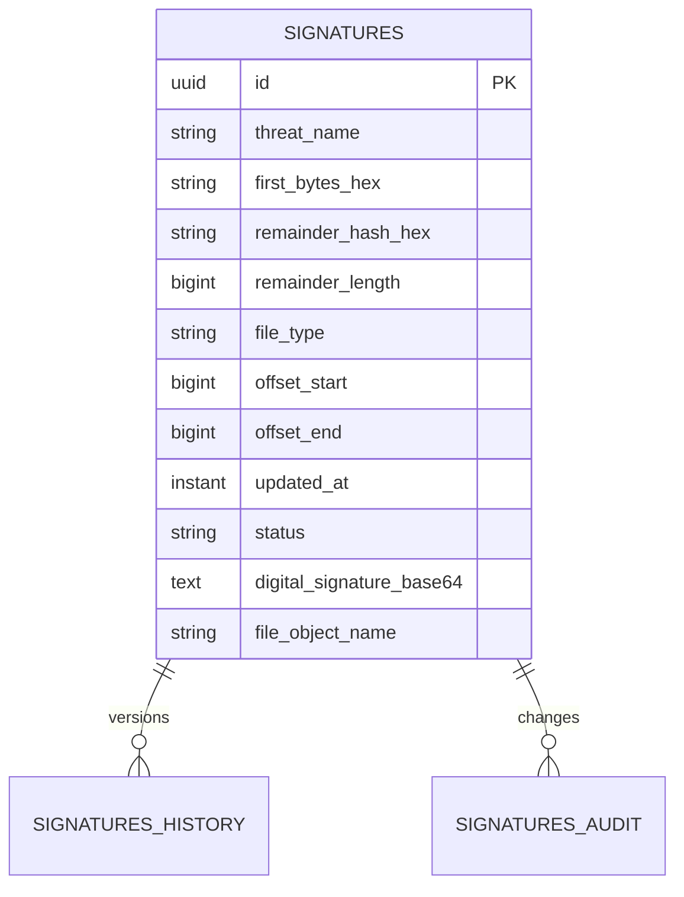

# Сервер лицензирования и антивирусных сигнатур

Учебный Spring Boot проект реализует JWT-аутентификацию, ролевую авторизацию, управление лицензиями, электронную подпись, восемь операций с антивирусными сигнатурами, бинарный `multipart/mixed` API и опциональную загрузку файлов в приватное хранилище MinIO.

## Быстрая проверка

Требования: Java 21, Maven 3.9+, Docker Compose и PKCS12-хранилище `src/main/resources/keystore.p12` с RSA-ключом и сертификатом.

```bash
cp .env.example .env
docker compose up -d
set -a && source .env && set +a
mvn test
mvn spring-boot:run
```

На Windows переменные из `.env` можно загрузить в IDE или задать в PowerShell перед запуском. Сервер работает по HTTPS на `https://localhost:8443`.

Для защиты на Windows подготовлена пошаговая инструкция `DEFENSE-CLICK-GUIDE-RU.md`, готовая коллекция Postman `demo/ZIiVPO-2025.postman_collection.json` и резервная автоматическая проверка `scripts/run-defense-demo.ps1`.

## Что показывать по критериям

### Задание 1 Репозиторий и базовая безопасность

| Критерий | Доказательство в проекте |
|---|---|
| Новый репозиторий | История Git содержит отдельные коммиты по заданиям 1-6 |
| JWT access и refresh | `JwtService`, `JwtFilter`, `TokenPairService`; refresh-токен одноразовый и хранится в `user_sessions` |
| Ролевая модель | `SecurityConfig` и `@PreAuthorize`; роли `ROLE_USER` и `ROLE_ADMIN` |
| HTTPS | `server.ssl` в `application.yml`, PKCS12-хранилище восстанавливается в CI |
| PostgreSQL | Spring Data JPA, PostgreSQL driver и контейнер `postgres` в `docker-compose.yml` |
| Переменные и секреты | Все секреты читаются из environment variables; пример имён находится в `.env.example`, файл `.env` игнорируется Git |
| Pipeline test и build | GitHub Actions отдельно выполняет `mvn -B test` и сборку JAR, затем публикует artifact |

Публичная регистрация всегда создаёт `ROLE_USER`. Создание нового администратора вынесено в защищённый `POST /auth/admin/register`, доступный только действующему администратору.
При первом запуске начального администратора можно создать через `BOOTSTRAP_ADMIN_USERNAME` и `BOOTSTRAP_ADMIN_PASSWORD`; после создания эти переменные рекомендуется удалить. `schema.sql` добавляет внешние ключи между основными таблицами лицензий и сигнатур.

### Задание 2 Управление лицензиями

Сущности: `License`, `LicenseType`, `Product`, `Device`, `DeviceLicense`, `LicenseHistory`. `LicenseService` создаёт, активирует, проверяет и продлевает лицензию. Ответ проверки и активации содержит `Ticket` и ЭЦП в `TicketResponse`.

Поля `Ticket`: время сервера, время жизни, дата активации, дата истечения, идентификаторы пользователя и устройства, флаг блокировки. Ошибка подписи не маскируется строкой-заглушкой: запрос завершается ошибкой, поэтому неподписанный тикет клиенту не выдаётся.



Последовательность активации:



### Задание 3 Электронная подпись

`SignatureKeyStoreService` загружает приватный RSA-ключ и публичный сертификат из PKCS12. `DigitalSignatureService` подписывает канонический JSON методом `SHA256withRSA`, проверяет подпись и отдельно подписывает массив байт для бинарного API. `JsonCanonicalizer` сортирует поля, чтобы одинаковые данные давали одинаковое подписываемое представление.

В GitHub repository settings необходимо создать secrets:

- `KEYSTORE_B64` - PKCS12 в Base64;
- `SIGNATURE_PUBLIC_CERT_B64` - публичный сертификат в Base64;
- `KEYSTORE_PASSWORD` - пароль хранилища и ключа;
- `JWT_SECRET`, `DB_URL`, `DB_USERNAME`, `DB_PASSWORD`;
- `MINIO_ACCESS_KEY`, `MINIO_SECRET_KEY`.

Публичный сертификат хранится отдельно в `SIGNATURE_PUBLIC_CERT_B64` и публикуется вместе с JAR artifact для передачи клиентской команде. Наличие GitHub secret невозможно доказать исходным кодом, поэтому на защите откройте `Settings -> Secrets and variables -> Actions` и покажите только список имён, без значений.

### Задание 4 Антивирусные сигнатуры

| Операция | Endpoint | Доступ |
|---|---|---|
| Добавление | `POST /api/signatures` | ADMIN |
| Обновление | `PUT /api/signatures/{id}` | ADMIN |
| Логическое удаление | `DELETE /api/signatures/{id}` | ADMIN |
| Полная выгрузка | `GET /api/signatures` | USER ADMIN |
| Инкремент | `GET /api/signatures/increment?since=...` | USER ADMIN |
| Получение по идентификаторам | `POST /api/signatures/by-ids` | USER ADMIN |
| История | `GET /api/signatures/{id}/history` | ADMIN |
| Аудит | `GET /api/signatures/{id}/audit` | ADMIN |

При create и update пересчитывается подпись. Delete меняет статус на `DELETED`, обновляет `updatedAt`, также пересчитывает подпись и сохраняет предыдущую версию в History. Create, update и delete создают Audit. Полная выгрузка выбирает только `ACTUAL`; инкремент выбирает все записи с `updatedAt > since`, включая `DELETED`.



### Задание 5 Бинарный API

Endpoints: `GET /api/binary/signatures/full`, `GET /api/binary/signatures/increment`, `POST /api/binary/signatures/by-ids`. Ответ имеет тип `multipart/mixed` и две части: `manifest.bin` и `data.bin`.

Все целые числа сериализуются в Big Endian. `data.bin` начинается с magic number `DB-Erdeneuul`, версии и количества записей. `manifest.bin` начинается с `MF-Erdeneuul`, содержит тип выгрузки, даты, количество записей, SHA-256 файла данных, offset и length каждой записи, ЭЦП каждой записи и ЭЦП всего манифеста.

### Задание 6 MinIO

`POST /api/admin/signatures/files/upload` вычисляет сигнатуру файла, сохраняет исходный файл в MinIO и связывает object name с записью БД. `POST /api/admin/signatures/files/presigned-urls` возвращает URL на один час по списку идентификаторов.

`docker-compose.yml` создаёт приватный bucket `av-signature` и отдельного пользователя приложения. Spring Boot получает его `MINIO_ACCESS_KEY` и `MINIO_SECRET_KEY`; root credentials используются только контейнером и одноразовой инициализацией.

## Сценарий демонстрации

1. Покажите зелёный GitHub Actions job и раскройте отдельные шаги `Test` и `Build JAR`.
2. Выполните `mvn test` и покажите число успешно пройденных тестов.
3. Выполните `docker compose ps`: PostgreSQL и MinIO должны быть healthy.
4. Войдите администратором, покажите access и refresh token, затем обновите пару токенов через `/auth/refresh`.
5. Создайте тип лицензии, продукт и лицензию; активируйте её; покажите все поля `Ticket` и непустую Base64-подпись.
6. Создайте сигнатуру, обновите её, удалите; покажите History, Audit, полную выгрузку без удалённой записи и инкремент с удалённой записью.
7. Откройте бинарный endpoint и покажите заголовок `Content-Type: multipart/mixed`, две части и magic numbers в hex viewer.
8. Загрузите тестовый файл в MinIO, получите pre-signed URL, откройте его и покажите, что anonymous access к bucket запрещён.

## Полезные команды

```bash
mvn test
mvn clean package
docker compose config
docker compose up -d
docker compose ps
```

Перед защитой не показывайте значения secrets. Достаточно показать их имена и использование через `${...}` в конфигурации.
